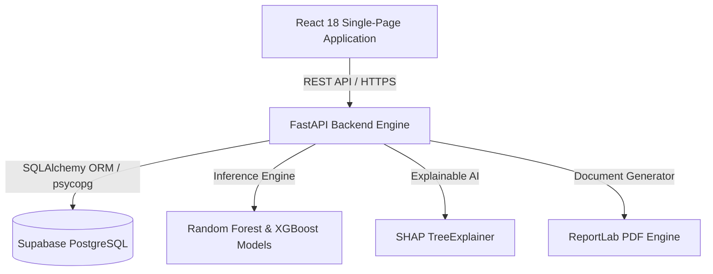

# AI-Driven Enterprise Decision Support Platform Using Machine Learning

> **An Explainable AI-Driven Customer Churn Prediction & Sales Forecasting System**

[](https://fastapi.tiangolo.com)
[](https://react.dev)
[](https://supabase.com)
[](https://python.org)
[](https://scikit-learn.org)
[](https://xgboost.readthedocs.io)

---

## 📌 Project Overview

The **AI-Driven Enterprise Decision Support Platform** is an end-to-end intelligent decision-making system designed for modern e-commerce enterprises. It integrates machine learning predictive models, explainable AI (XAI), and automated decision playbooks with an interactive customer storefront (**SmartCart**) and an executive management dashboard.

The platform forecasts revenue trends, detects customer churn risk before customer drop-off, explains root causes via SHAP (SHapley Additive exPlanations), and delivers targeted retention perks directly to customers during checkout.

---

## 🏛 System Architecture

The platform follows a decoupled, three-tier enterprise architecture:



### Key Subsystems:
1. **Executive Analytics Dashboard:**
   - Real-time KPIs (Total Customers, Churn Rates, High-Risk Accounts, Customer Lifetime Value).
   - Categorical churn summaries, RFM (Recency, Frequency, Monetary) metrics, and segmentation.
2. **Explainable AI (XAI) Churn Prediction:**
   - Ensemble Random Forest and XGBoost classification models.
   - Real-time SHAP waterfall feature attribution explaining specific drivers behind each customer's risk profile.
3. **Multi-Horizon Sales Forecasting:**
   - XGBoost time-series regression with scenario modeling (Expected, Optimistic, Conservative).
   - Dynamic 7-day to 90-day demand and revenue projections.
4. **Automated Decision Engine & SmartCart Storefront:**
   - Automated retention playbook that issues targeted discount coupons, free shipping, and loyalty upgrades based on churn risk category.
   - Interactive consumer storefront with product catalog, cart isolation, and checkout coupon redemption.
5. **Executive PDF Reporting:**
   - Automated report compilation with ReportLab delivering boardroom-ready PDF intelligence summaries.

---

## 🛠 Technology Stack

| Layer | Technologies |
| :--- | :--- |
| **Frontend** | React 18, Vite, React Router DOM, Chart.js, Recharts, Lucide Icons, CSS Modules |
| **Backend API** | FastAPI, Uvicorn, Pydantic v2, Starlette, Python-Dotenv |
| **Database & ORM** | Supabase PostgreSQL, SQLAlchemy 2.0, Psycopg 3, Session & Transaction Poolers |
| **Machine Learning** | Scikit-learn, XGBoost, SHAP, Joblib, NumPy, Pandas |
| **Reporting & Export** | ReportLab, Matplotlib |
| **Testing & CI** | Pytest, FastAPI TestClient, Automated Data Integrity & Parity Suites |

---

## 📂 Repository Directory Structure

```text
EnterpriseDecisionPlatform/
├── backend/                  # FastAPI Application
│   ├── app/
│   │   ├── api/              # REST Endpoints (Dashboard, Churn, Store, Forecast)
│   │   ├── db/               # SQLAlchemy Models & Session Pooler Config
│   │   ├── ml/               # Model Loaders, Predictors, SHAP & Decision Engine
│   │   └── services/         # Customer Feature Aggregator & PDF Generator
│   ├── main.py               # Backend Application Entrypoint
│   └── .env.example          # Backend Environment Template
├── frontend/                 # React 18 SPA (Vite)
│   ├── src/
│   │   ├── components/       # UI Components, Modals, Navigation
│   │   ├── pages/            # Executive Pages & SmartCart Storefront
│   │   └── services/         # Axios API Client Handlers
│   ├── index.html
│   ├── package.json
│   └── .env.example          # Frontend Environment Template
├── database/                 # Database Migrations & Validation
│   ├── migrations/           # 001_initial_schema.sql (PostgreSQL DDL)
│   ├── scripts/              # Migration & Verification Runners
│   └── MIGRATION_FINAL_REPORT.md # Migration Audit & Parity Report
├── dataset/                  # Cleaned Datasets & Historical Batches
│   ├── customer churn/       # Churn training & batch evaluation datasets
│   └── sales forecast/       # Store sales transaction logs
├── models/                   # Serialized ML Model Artifacts (.joblib, .json)
├── report/                   # Academic LaTeX Project Documentation & Evidence
├── tools/                    # Validation, Regression & DB Verification Utilities
├── requirements.txt          # Python Production Dependencies
└── README.md                 # Project Documentation
```

---

## 🚀 Quickstart Guide

### 1. Prerequisites
- Python 3.11+
- Node.js 18+ and npm
- A PostgreSQL database (e.g., [Supabase](https://supabase.com))

### 2. Backend Setup

```bash
# Clone the repository
git clone https://github.com/joyal77/AI-Driven-Enterprise-Decision-Support-Platform-Using-ML.git
cd AI-Driven-Enterprise-Decision-Support-Platform-Using-ML

# Create and activate Python virtual environment
python -m venv venv
# On Windows:
.\venv\Scripts\activate
# On Linux/macOS:
source venv/bin/activate

# Install dependencies
pip install -r requirements.txt

# Configure environment variables
cp backend/.env.example backend/.env
# Edit backend/.env with your Supabase PostgreSQL connection string
```

### 3. Database Migration & Initialization

```bash
# Run schema migration and verification
python database/scripts/migrate_mysql_to_postgres.py
python database/scripts/verify_migration.py

# Run comprehensive regression suite
python tools/run_regression_suite.py
```

### 4. Start Backend Server

```bash
uvicorn backend.main:app --host 0.0.0.0 --port 8000 --reload
```
API Documentation will be available at `http://127.0.0.1:8000/docs`.

### 5. Frontend Setup

```bash
cd frontend

# Install dependencies
npm install

# Configure environment variables
cp .env.example .env.local

# Launch development server
npm run dev
```
The React frontend will be accessible at `http://localhost:5173`.

---

## 🧪 Testing & Verification

The repository includes a comprehensive 12-point regression suite verifying all critical paths against the live PostgreSQL database:

```bash
python tools/run_regression_suite.py
```
- Health Check & Database Engine
- Executive Dashboard KPIs & Categorical Churn Aggregations
- Customer Listing, Pagination & RFM Feature Profiling
- Storefront Product Catalog, Cart Isolation & Order Placement
- Random Forest ML Churn Inference & SHAP Explainability
- Decision Engine Retention Perks & Coupon Redemptions
- XGBoost Multi-Horizon Sales Forecasting & Scenario Modeling
- ReportLab Executive PDF Document Compilation

---

## 📜 Academic Details

- **Student:** Joyal Jobai (Roll No: 34)
- **Programme:** Master of Computer Applications (MCA), Course Code: 20MCA245
- **Institution:** Adi Shankara Institute of Engineering & Technology (ASIET), Kalady
- **Affiliation:** APJ Abdul Kalam Technological University, Kerala
- **Project Guide:** Sukrith Lal (Assistant Professor, Dept. of Computer Applications)
- **Academic Year:** 2026

---

## ⚖️ License & Confidentiality

This project is developed for academic and evaluation purposes. All sensitive configuration parameters are externalized into gitignored environment variables.
